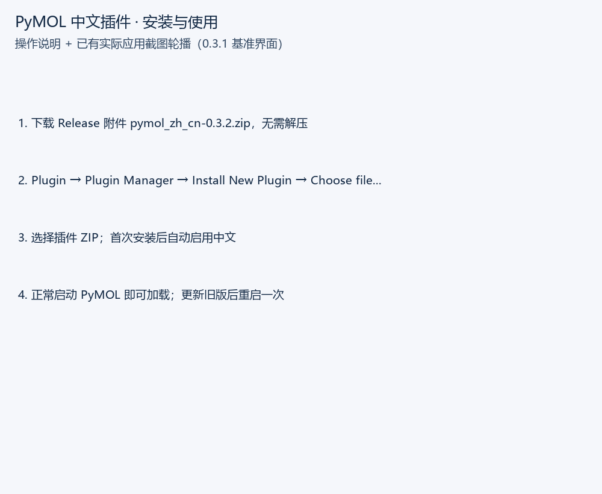

# 安装与使用演示

动图由安装说明卡与开发阶段的实际应用截图组成，用于演示操作路径；界面截图来自 0.3.1 基准环境，0.3.2 保留这些操作入口。

1. **安装**：下载 Release 中的 `pymol_zh_cn-0.3.2.zip`，在 `Plugin → Plugin Manager → Install New Plugin → Choose file...` 选择 ZIP。
2. **自动中文**：首次安装后直接显示中文，正常启动也会自动加载；更新旧版本后重启一次。
3. **对象操作**：右侧选中对象或选区，再使用 A 动作、S 显示、H 隐藏、L 标签或 C 颜色。这里执行 PyMOL 原始命令。
4. **设置检索**：高级设置窗口输入中文名称、说明或英文键，例如 `line_width`；编辑后原参数值按原版逻辑处理。
5. **切换英文**：在 `插件 → 中文显示 / Chinese Display` 选择“恢复英文显示”；选择“启用中文显示”可切回。

遇到安装、字体或窗口布局问题，参阅[故障排查](TROUBLESHOOTING.md)。英文教程中的命令仍按原语法输入，常用词汇见[中英术语表](GLOSSARY.md)。
