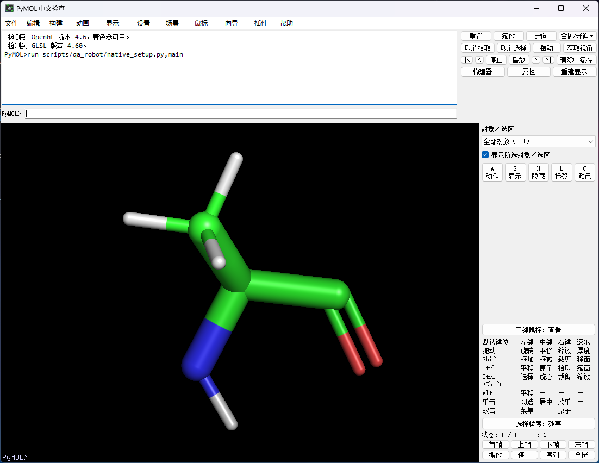
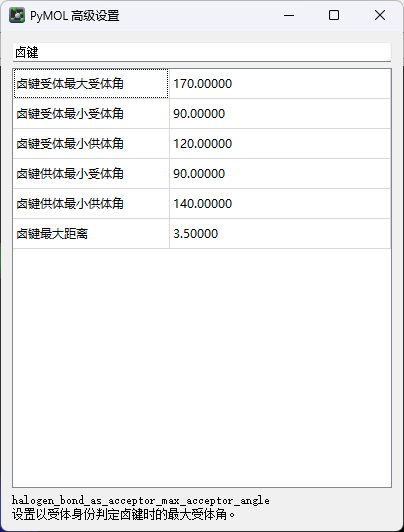

# 0.3.1 检查范围

基准：Windows、conda-forge PyMOL Open-Source 3.1.0（`py312h7aa25ef_8`）、Python 3.12、PyQt5 / Qt 5.15.15。

本记录汇总 0.3.1 开发完成后的程序检查与实际桌面检查。实际截图在开发阶段统一完成；发布整理期间没有重新操作用户桌面。

## 程序与资源检查

- 20 项控件回归通过，包含中文绘制、原始英文值保留、下拉列表选择与代理恢复，以及绘制参数类型回归。
- 779/779 项设置有中文名称与简要说明；支持中文和英文键搜索，编辑仍通过原模型处理。
- 299 篇独立帮助、含别名共 330 个主题；549 段语法、API 和代码示例保持原文，原函数 docstring 不变。覆盖普通文本及原版 HTML 控制台空行格式。
- 匹配源码中盘点的 1331 条反馈与错误句式均有映射；输出词典共 1383 条。动态路径、对象名、数值、标识及代码保留原文。
- 原版 Qt 界面和引擎检查通过，包含 9 种标签模式、属性编辑、英文模型及语言切换。
- 19 个原版表单、24 个页面，在 100%、125%、150%、200% 离屏缩放下各检查 151 处译文，未发现已检查文字尺寸不足或被父控件裁切。
- 对照安装元数据，273 个原版 Python/UI 文件哈希一致。
- 标准插件安装器在隔离用户目录安装 ZIP；首次安装当前窗口显示中文，独立新进程经正常插件发现与自动加载流程启用中文。

## 实际桌面与键鼠检查

使用 Java `java.awt.Robot` 截取实际屏幕像素并查看，检查乱码、缺字、截断、重叠、按钮位置和窗口边界；用真实鼠标、滚轮和键盘操作，并读取原引擎值判断结果。屏幕为 2560×1440。

| 范围 | 已检查内容 |
| --- | --- |
| 主界面、右侧与右下角 | 100% 与 200% 中文显示；200% 窗口位于屏幕内 |
| 高级设置 | 中文筛选；实际将线宽改为 3 并恢复 1.49；原引擎值一致 |
| 导入 | 密度图、轨迹、Maestro、MTZ 窗口；轨迹选项勾选；Maestro 真实下拉选择后英文原值及 `multiplex=1` 保留 |
| 导出 | PNG 长说明及透明背景下拉；动画光追与 480p 切换；原尺寸逻辑保留 |
| 标签向导 | 模式下拉、消息开关和拾取提示；真实切换有效 |
| 异常和控制台 | 原版异常详情展开；`help load` 中文帮助、原语法保留；文字控制台实际滚轮后无旧画面残留 |
| 语言切换 | 插件菜单恢复英文，再次启用中文；原英文控制台与 OpenGL 侧栏恢复 |

12 份操作快照中的测试分子坐标一致。实际桌面检查中的导入导出窗口主要在 100% 下查看，200% 覆盖主界面、设置、侧栏及控制台。未对每一篇帮助、全部子菜单和所有第三方插件逐一进行实际桌面操作；这些范围按资源或程序检查报告。

## 发布检查的复现

脚本命令见 [README](../README.md#开发与检查)。检查会在本地生成 `artifacts/`，该目录不进入 Git；本仓库保留上述范围摘要及两张实际应用截图。
